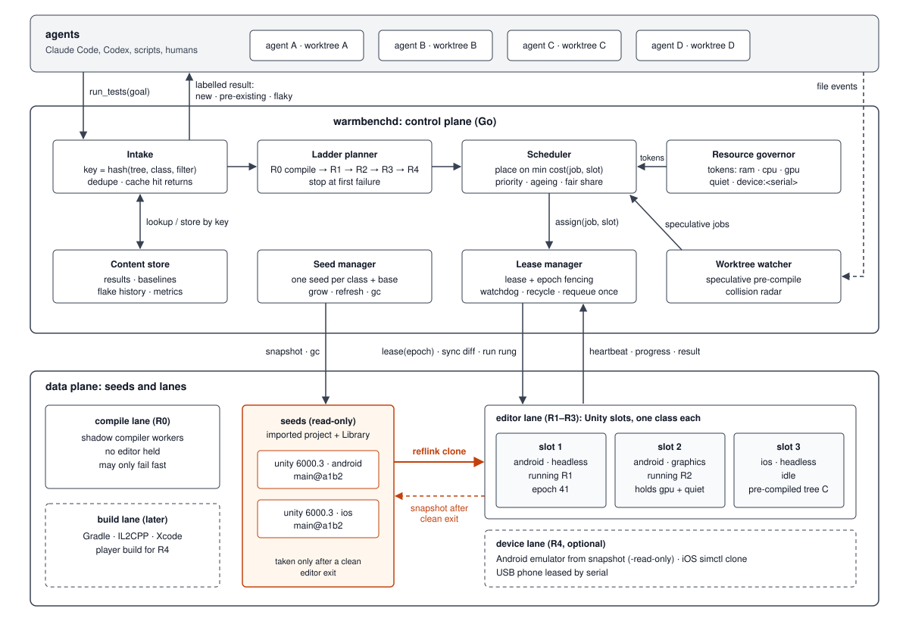

# warmbench

Keep Unity editors warm and share them between many coding agents on one machine.

Several AI coding agents working in parallel on one Unity project each need to run the Unity Test
Framework before they push. Today each run starts Unity cold (open, import, compile, reload, then
test), and agents queue blindly on a lock. warmbench is a small daemon that owns a pool of warm
editors, syncs each agent's changes into one, runs the tests, and returns structured results, with
a fair queue, ETAs and a result cache. Agents talk to it through MCP or a CLI.

**Status: design and scaffold only. Nothing works yet.** The first milestone is a spike that
measures cold against warm runs; see [docs/spike.md](docs/spike.md).



## Ideas in the design

- **Warm state as a forkable asset.** A fully imported project (`Library` included) is kept as a
  read-only *seed* per engine version, build target and base commit. Editor slots are grown from
  seeds by copy-on-write clone, so they are cheap to create and safe to throw away.
- **Build target is part of the warm state.** Android and iOS slots never serve each other's jobs,
  so no job pays a platform-switch reimport.
- **Verification ladder.** Compile first, then affected EditMode tests, affected PlayMode tests,
  full suites and an optional device smoke test; stop at the first failure.
- **Placement by cost.** A job goes to the slot that needs the least sync, compile and import work
  to match its tree.
- **Fast and lean.** Idle editors are frozen and their memory paged out instead of being shut down,
  slots share one page cache through overlay seeds, and every job ends with a memory and disk
  cleanup that runs after the agent already has its result.
- **Results agents can act on.** Failures are labelled new, pre-existing (also failing on the base
  branch) or flaky, and agents are warned when another agent edits the same scenes or prefabs.

Every performance claim is a hypothesis until the spike measures it.

## Documents

- [docs/DESIGN.md](docs/DESIGN.md): the problem, prior art, goals, interfaces, milestones.
- [docs/POOL.md](docs/POOL.md): the pool architecture: seeds, lanes, scheduler, memory and disk,
  slot lifecycle, results.
- [docs/spike.md](docs/spike.md): what milestone 1 measures, and the results once they exist.
- [docs/diagrams/](docs/diagrams): architecture, seeds, slot lifecycle, ladder, before/after.

## Layout

```
cmd/warmbench/          CLI client (stub)
cmd/warmbenchd/         daemon (stub)
internal/scheduler/     queue, ladder planner, placement
internal/slot/          slot lifecycle, leases, tiers, cleanup
internal/store/         content-addressed results, baselines, seeds, gc
internal/governor/      resource tokens and memory limits
internal/driver/        engine-agnostic slot protocol and the Unity driver
unity/com.warmbench.agent/   editor-only Unity package run inside each slot
docs/                   design documents and diagrams
```

## Licensing note

warmbench is MIT licensed (see [LICENSE](LICENSE)). It does not change Unity's licence terms.
Whether several Unity editors may run on one machine under your Unity licence is for you to check
against Unity's current terms; warmbench never starts more editors than you configure.

## Contributing

See [CONTRIBUTING.md](CONTRIBUTING.md). Until v0.1, please open an issue before sending code.
