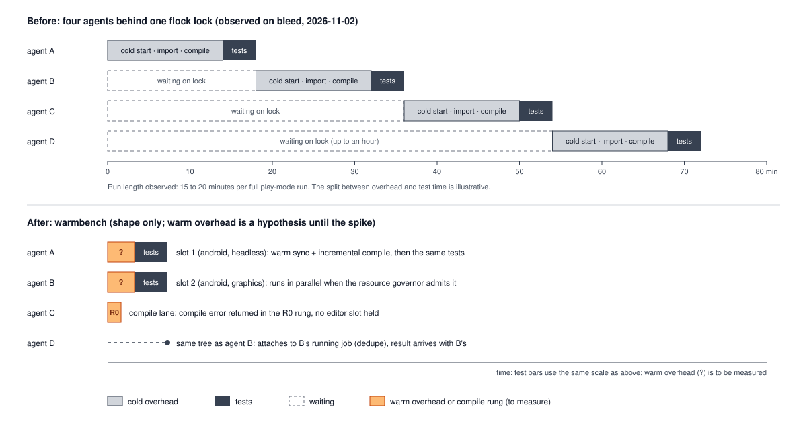
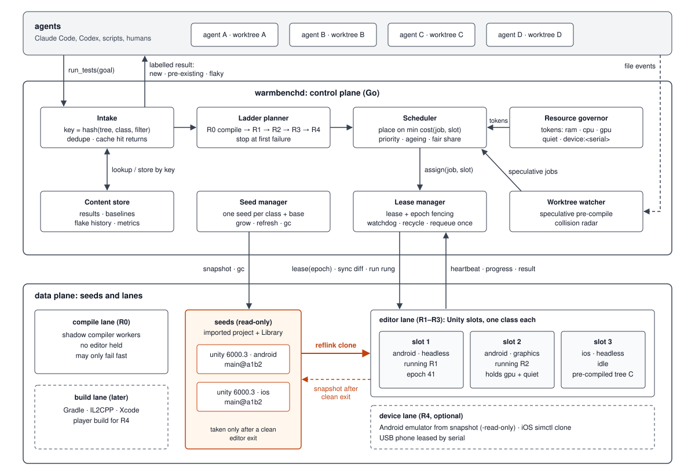
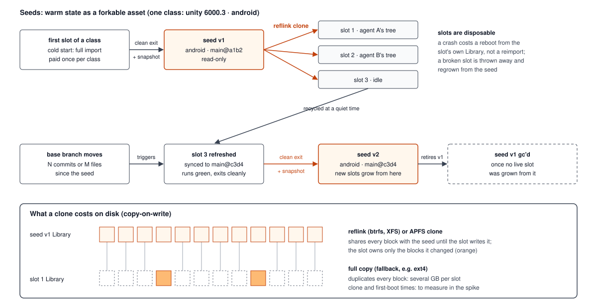
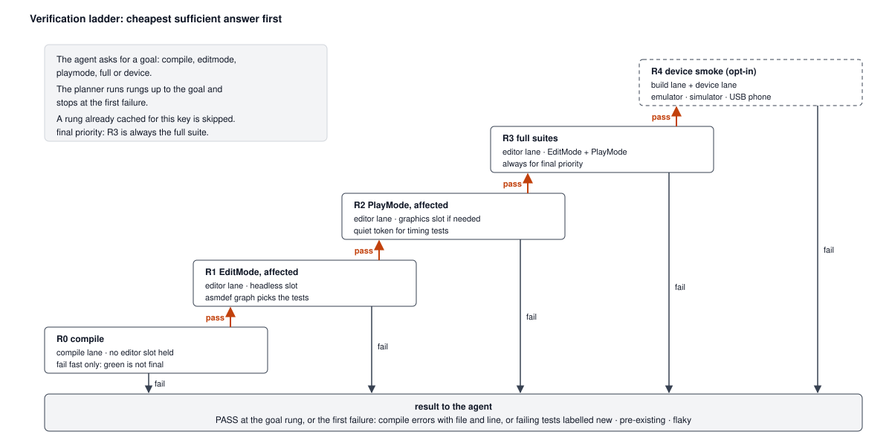
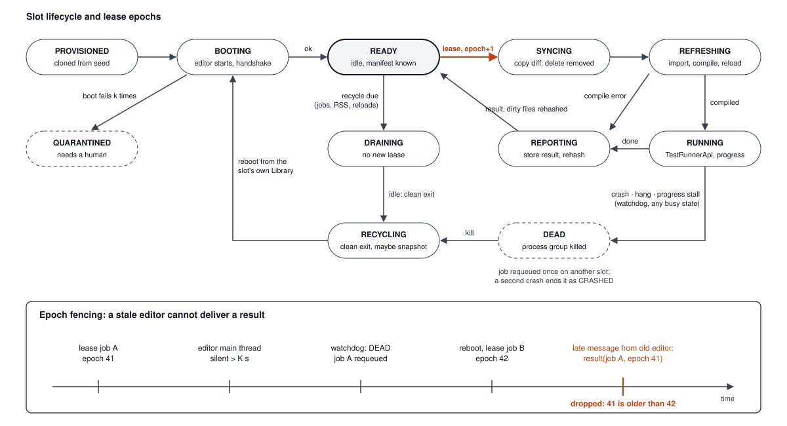

# warmbench: pool architecture

Status: draft, 2026-11-02. Design only; nothing here is measured yet. Every claim marked
**(measure)** must be checked in the spike (DESIGN.md section 10) before it is repeated in public.

This document replaces the plain "N long-lived editors" pool sketched in DESIGN.md section 4 with
a design aimed at mobile developers who run several coding agents at once. Sections 1 to 3 are the
brainstorm and the reasoning; sections 4 to 13 are the chosen architecture.

## 1. What is different about mobile + agents



The DESIGN.md problem (cold Unity starts, a blind `flock` queue) is real but generic. Mobile
projects add pressures that a plain editor pool does not handle:

1. **The build target is part of the warm state.** A Unity `Library` is imported for one active
   build target. Textures for Android (ASTC/ETC2) and iOS are compressed differently, and switching
   the target triggers a reimport and a domain reload. An editor warmed for Standalone is *not* warm
   for an Android job. A pool that ignores the target throws its warmth away on the first switch.
2. **There are three kinds of machine, not one.** Mobile verification runs on (a) the editor
   (EditMode / PlayMode tests), (b) a build toolchain (Gradle, IL2CPP, Xcode), and (c) a device
   (Android emulator, iOS simulator, a USB phone). Each is slow to start and fast once warm.
3. **iOS needs macOS.** A mobile team's agent loop spans at least two hosts or two OSes sooner or
   later; the pool cannot assume one Linux box forever.
4. **Agents are not humans.** They iterate faster, submit many near-identical trees, do not mind
   asynchronous answers, cannot tell a flaky or pre-existing failure from their own bug without
   help, and do not see each other's work. Each of these is a scheduling opportunity.
5. **Most agent iterations fail on compile errors**, not on tests (observed on bleed; **(measure)**
   the ratio). A pool that makes the agent wait for a full editor slot just to learn about a missing
   `using` wastes the scarcest resource.

## 2. Brainstorm: candidate architectures

| # | Idea | What it buys | Why not alone |
|---|---|---|---|
| A | **Fixed pool of long-lived editors** (DESIGN.md v1) | warm compile + domain | slots drift; target switches; disk copies are full GB copies; one crash loses the warmth |
| B | **Process snapshot / restore** (CRIU, like Firecracker snapshots for Lambda) | fork a fully warm editor in seconds | Unity holds GPU contexts, licence state, sockets; CRIU of a GPU process is not realistic. Rejected for the editor; kept for devices, where emulators already support snapshots |
| C | **Zygote-style warm parents** (Android forks every app from a pre-initialised Zygote process) applied at the *state* layer: keep one warm "seed" per (project, engine version, build target, base commit) and clone slots from it copy-on-write | new slots in seconds instead of a cold import; slots can be thrown away freely | needs a CoW filesystem (btrfs, XFS reflink, APFS); fallback is a plain copy |
| D | **Verification ladder**: cheapest check first, escalate only on success (compile-only, affected EditMode, affected PlayMode, full suites, device smoke) | agents get compile errors in seconds without holding an editor | needs a shadow compile path that agrees with Unity's (see 7) |
| E | **Speculative warming**: watch agents' worktrees and pre-sync / pre-compile an idle slot before the agent asks | removes sync + compile from the critical path | wasted work when the agent is still mid-edit; must be cancellable and lowest priority |
| F | **Baseline diffing**: every result is compared with the base commit's result for the same filter | tells the agent "these 3 failures already fail on main, not yours" | needs base results; the content cache makes them cheap |
| G | **Cross-agent collision radar**: the daemon sees every agent's tree, so it can warn when two agents edit the same scene, prefab or asmdef (Unity YAML merges badly) | merge pain found before the PR, not after | advisory only |
| H | **Local merge train**: test agents' branches stacked on each other before merge (like GitLab merge trains / Uber SubmitQueue) | catches semantic conflicts between agents | only useful once several PRs are queued for merge; later |
| I | **Device lanes**: emulators / simulators booted from snapshots, leased like slots | on-device smoke tests in the same queue | heavy on RAM; off by default |

**Choice:** C + D + E + F as the core, with A's long-lived editors as the execution unit, G as a cheap
add-on, I as an optional lane, H later. The new idea is the combination: **the pool manages warm
*state* as a content-addressed, forkable asset, and treats editor processes as disposable workers
grown from it.** A slot is cattle; its seed is the pet.

## 3. Design principles

1. **State outlives processes.** Warmth lives in the seed and the slot's `Library` on disk, not only
   in RAM. A crashed or recycled editor costs a domain reload, not a full import.
2. **Everything is keyed by content.** Trees, seeds, results and baselines are all addressed by hash,
   so dedupe, caching and "closest slot" fall out of the same data.
3. **Cheapest sufficient answer first.** Never spend a PlayMode slot to report a compile error.
4. **The scheduler knows what a switch costs.** Placement is a cost model, not round-robin.
5. **Engine-agnostic core.** Scheduler, store and MCP layer hold no Unity types; Unity is one
   *driver*. Godot, Unreal, Gradle-only Android and Xcode-only iOS projects are other drivers.

## 4. Overview



Agents submit to the control plane, which keys, plans, schedules and leases each job. Editor slots are grown by copy-on-write clone from read-only seeds and snapshotted back into seeds after a clean exit. Dashed boxes are optional or later. Text version:

```
            agents (Claude Code, Codex, scripts, humans)
                 | MCP / CLI / HTTP
                 v
 +-------------------------------------------------------------+
 | warmbenchd  (control plane, Go)                             |
 |                                                             |
 |  intake --> ladder planner --> scheduler --> lease manager  |
 |    |             |                 ^   |          |         |
 |    v             v                 |   v          v         |
 |  content store: trees, results, baselines, seeds, metrics   |
 |    ^                               |                        |
 |  worktree watcher (speculation)    resource governor        |
 |  collision radar                   (RAM, CPU, GPU, devices) |
 +-------------------------------------------------------------+
        | driver protocol (JSON lines over Unix socket / named pipe / later mTLS TCP)
        v
 +---------------------- data plane ----------------------------+
 | seeds (read-only, CoW source)                                |
 |   unity-6000.3/android/main@a1b2   unity-6000.3/ios/main@a1b2 |
 |        | reflink clone                                        |
 |        v                                                      |
 | lanes                                                         |
 |   compile lane : shadow compiler workers (no editor)          |
 |   editor lane  : slots = Unity editors (headless | graphics)  |
 |   build lane   : Gradle / IL2CPP / Xcode workers (later)      |
 |   device lane  : emulators / simulators / USB phones (opt.)   |
 +---------------------------------------------------------------+
```

## 5. Pool partitions

A slot can only serve jobs of its **class**:

```
class = (driver, project id, engine version, build target, slot kind)
         unity   bleed       6000.3.26f1     Android       headless|graphics
```

- `build target` is a class key, not a job option, because switching it costs a reimport. A job
  that asks for iOS never lands on an Android slot; if no iOS slot exists, one is grown from the
  iOS seed (or the seed is created first).
- `packages fingerprint` (hash of `Packages/manifest.json` + `packages-lock.json`) is a *slot
  attribute*, not a class key: a mismatch is allowed but costs a package resolve, and the cost
  model charges for it (section 8).
- Classes share one global resource budget (section 9). Idle slots of a cold class are evicted
  (LRU) when a hot class needs room.

## 6. Seeds: the warm-state store



A **seed** is a read-only, fully imported project directory: `Assets/ Packages/ ProjectSettings/`
plus `Library/` for one class at one base commit, taken from a cleanly shut-down editor.

```
/var/lib/warmbench/
  seeds/<class>/<base-tree-hash>/          read-only
  slots/<class>/<slot-id>/                 reflink clone of a seed, then mutated
  store/results/<job-key>.json + .xml + .log
  store/baselines/<class>/<base-tree>/<filter-hash>.json
  state/slots/<slot-id>.json               pid, socket, epoch, manifest, counters
  state/warmbench.db                       SQLite: jobs, leases, metrics
```

Lifecycle:

1. **Bootstrap.** The first slot of a class is a cold start (the only one paid in full). When it
   has finished import and compile and runs one green job, the daemon shuts it down cleanly at a
   quiet moment and snapshots its project dir as the class's first seed.
2. **Grow.** New slots are `cp --reflink=always` (Linux btrfs/XFS) or `clonefile` / `cp -c` (macOS
   APFS) of the newest seed: seconds and almost no extra disk, instead of a multi-GB copy. On
   filesystems without reflink the daemon falls back to a full copy and says so in `warmbench
   slots`. **(measure)** clone time and first-boot time from a seed.
3. **Refresh.** When the base branch moves far enough (configurable: N commits or M changed files
   since the seed), the next recycled slot is synced to the new base, run green, shut down, and
   snapshotted as a new seed. Old seeds are kept until no slot was grown from them, then gc'd.
4. **Never from a running editor.** Copying a `Library` while the editor writes to it can capture
   a torn state. Seeds are only taken after `EditorApplication.Exit(0)`.

Unity Accelerator, if configured, stays useful underneath: it shares import artifacts between seeds
of different commits.

## 7. Lanes and the verification ladder



An agent asks for a **goal** (`compile`, `editmode`, `playmode`, `full`, `device`); the ladder
planner turns it into rungs and runs them in order, stopping at the first failure:

| Rung | Lane | What runs | Typical holder time (to measure) |
|---|---|---|---|
| R0 compile | compile lane | shadow compile of changed assemblies and their dependents | seconds |
| R1 editmode-affected | editor lane, headless | EditMode tests in assemblies affected by the change | short |
| R2 playmode-affected | editor lane, graphics if needed | PlayMode tests in affected assemblies | medium |
| R3 full | editor lane | full EditMode + PlayMode suites (always for `final` priority) | long |
| R4 device | build + device lanes | player build for the target, install, smoke scene on emulator / simulator | long; opt-in |

Rules:
- `final` priority always runs R3 in full, never "affected only".
- A rung whose result is already in the store for this key is skipped.
- R0 failing returns compile errors in the format Unity would print, with file and line.

**Shadow compile lane (R0), the riskiest idea.** Unity writes `.csproj` files for IDEs; the lane
would compile those with the bundled Roslyn / `dotnet build` against the slot's
`Library/ScriptAssemblies`, without opening an editor. It does not run IL post-processors or source
generators the same way Unity does, so it can disagree. Policy: R0 may only **fail fast**; a green
R0 is never reported as "compiles" to the agent, it only lets the job climb to R1, where Unity's
own compile is authoritative. If the spike shows disagreement is common, R0 falls back to "refresh
and compile in a headless slot, then release it" (still cheaper than holding a PlayMode slot).
**(measure)** agreement rate on bleed's history.

**Affected assemblies** come from the asmdef graph: changed files map to their assembly, then to
every assembly that references it.

## 8. Scheduler and placement

Event-driven, one goroutine owns the scheduling state (actor model); events are job submitted,
rung finished, slot idle / ready / dead, resources changed, watcher saw a change.

**Job order** within a class: priority class (`final` > `normal` > `explore` > `speculative`),
then age with ageing so nothing starves, then a per-agent fair share (an agent with 5 queued jobs
does not starve one with 1).

**Placement cost** for job J on idle slot S:

```
cost(J, S) =  w_sync    * files_to_sync(S.manifest, J.tree)
            + w_compile * sum(compile_cost(a) for a in assemblies_dirtied(S, J))
            + w_import  * sum(import_cost(f) for f in assets_changed(S, J))
            + w_pkg     * (S.packages != J.packages)      # package resolve, large
            + w_health  * S.jobs_since_boot / recycle_limit
```

Per-file and per-assembly costs are learned from past jobs (moving averages), starting from
constants. The slot with the lowest cost wins. If the best cost is above a threshold and a fresh
slot can be grown from a seed closer to J's tree, the scheduler grows instead of reusing. This is
what makes an agent that keeps iterating on one worktree land on "its" slot without any explicit
stickiness.

**Dedupe.** A job whose key equals a running job's key attaches to it (singleflight). A newer job
from the same worktree + label supersedes a queued older one.

**Speculation (E).** The worktree watcher (inotify / FSEvents) notices agents' edits. When the queue
for a class is empty and a slot is idle, and a worktree has been quiet for a short debounce
(default 20 s), the scheduler leases that slot to a `speculative` job that syncs and compiles the
worktree's tree but runs no tests. If the agent then submits that tree, the job finds a slot whose
manifest already matches: sync and compile cost are near zero. Speculative jobs are preempted
instantly by any real job and never count toward results.

## 9. Resource governor

Each rung declares the resources it needs, and the governor hands out tokens:

| Token | Supply | Taken by |
|---|---|---|
| `ram` (MB) | free RAM minus a reserve | every running slot, sized from its observed peak RSS |
| `cpu` | cores | compile and import phases (heavy), test phases (light) |
| `gpu` | 1 by default | graphics PlayMode rungs and emulators with GPU |
| `quiet` | 1 | rungs marked timing-sensitive |
| `device:<serial>` | 1 per device | device rungs |

The `quiet` token is the answer to "play-mode timing tests fail when other editors compile": while
a quiet rung runs, the governor admits no compile/import phases anywhere on the host; running
EditMode tests may continue. Tests opt in with a category (for example `[Category("Timing")]`), so
the rest of the suite does not pay for it.

Slot count is therefore not a fixed number: `min` and `max` per class come from config, and the
governor decides how many can be live at once from measured RAM and CPU (section 10.2). Default on
one machine: `max_hot` computed from RAM (at most 1 graphics + 1 headless running), idle slots
frozen rather than exited, compile lane workers started on demand (at most 2), no device lane.

## 10. Memory and disk: fast and lean at the same time

Requirement (owner, 2026-11-02): speed must not be compromised, and memory and disk must still be
at an optimal level, with cleanup after every agent's Unity test. Where nothing existing does both,
invent it.

### 10.1 Where the memory goes (honest assessment of sections 4 to 9)

Sections 4 to 9 optimise for latency. Measured against memory they are not frugal:

| Consumer | Resident memory | In the earlier draft |
|---|---|---|
| Unity editor slot, idle with a warm domain | several GB per slot, grows with domain reloads **(measure)** | 1 graphics + 1 headless slot always running, even with no agent working |
| Unity editor slot in PlayMode | its idle size plus the scene and test peak **(measure)** | two can peak at the same time |
| Shadow compile workers | a few hundred MB each **(measure)** | cores / 4 workers kept alive |
| Emulator / simulator | GBs each | optional lane |
| Identical data in every slot | each editor loads the same engine assemblies, packages and `Library` artifacts into its own memory | counted once per slot |
| warmbenchd (Go) | small; target under 50 MB, logs streamed, not buffered | n/a |

Today on bleed only one editor runs at a time (the `flock`) and it exits after each run. The
earlier draft would have used **more** RAM than today, permanently, even while idle. The obvious
fix, shutting idle editors down, gives the speed back away: the next job pays an editor boot and a
domain load. Both options are bad, so the design takes neither. Four mechanisms, most of them new
for editor tooling, keep the editor hot in effect while it takes almost no RAM.

### 10.2 Invention 1: freeze-dried editors

An idle editor does not need to be *running* to be hot; it needs its memory to come back fast.
Linux can do this without the editor's co-operation:

1. **Freeze.** When a slot goes idle, the daemon freezes its cgroup (`cgroup.freeze = 1`). The
   editor is stopped mid-air: domain loaded, assemblies JITted, sockets open.
2. **Dry.** The daemon then asks the kernel to push the frozen slot's memory out: `memory.reclaim`
   on the slot's cgroup (or `process_madvise(MADV_PAGEOUT)` on its ranges). Pages go to zswap
   (compressed, still in RAM) or to an NVMe swap file. The slot's resident memory drops to a
   fraction of its size **(measure)**.
3. **Pre-thaw.** When a job is likely (the worktree watcher sees an agent editing, or a job is
   queued behind a running one), the daemon pages the slot's memory back in *while it is still
   frozen*, with `process_madvise(MADV_WILLNEED)` and readahead. This uses idle disk bandwidth
   while the agent is still typing.
4. **Thaw.** When the job is leased, `cgroup.freeze = 0`. The editor continues where it stopped:
   no boot, no domain reload, no recompile of untouched assemblies.

Thaw cost is the page-in of the editor's working set from compressed RAM or NVMe, and pre-thaw
hides most of it. A boot plus a domain reload is the cost it replaces. Both are **(measure)**; the
spike must show thaw is clearly faster than a warm boot, or this tier is dropped.

Safety:
- The watchdog knows a slot is frozen and suspends its heartbeat limits.
- Freezing only happens between jobs, never during one.
- Unity's licensing client runs as a separate process and is not frozen. Whether a long-frozen
  editor keeps its licence session is **(measure)**; the freeze is capped by `max_frozen`
  (default 8 h), after which the slot is exited to WARM.
- It needs swap or zswap. `warmbench doctor` checks this and prints the commands to enable zswap
  or a swap file; without either, the FROZEN tier is skipped and idle slots go straight to WARM.
- macOS and Windows have no cgroup freezer. A fallback, weaker but on the same principle: `SIGSTOP`
  plus the OS memory compressor on macOS, and suspend plus `EmptyWorkingSet` on Windows. Measure
  these separately.

### 10.3 Invention 2: one page cache for all slots (overlay seeds)

Reflink clones (section 6) save disk, but each clone is a separate file to the kernel, so every
slot that reads the same `Library` artifact caches its own copy in RAM. With four slots, the same
gigabytes of imported textures and compiled assemblies can sit in the page cache four times.

Instead, a slot's project dir is an **overlay**:
- `lowerdir` = the seed (read-only, shared by every slot of the class)
- `upperdir` = the slot's own changes (synced files, newly imported artifacts)

Unchanged files are the *same* file for every slot, so the kernel caches them once. That saves
disk (only changed files are stored per slot) and RAM (one page cache for the shared bulk). It
uses unprivileged overlayfs in a user namespace (Linux 5.11+), with `fuse-overlayfs` or reflink
clones as fallbacks. Risks to measure: a file is copied up whole on its first write (LMDB files in
`Library` such as the artifact database will be copied up once per slot), and overlay write speed
during import.

### 10.4 Invention 3: merge identical memory across editors (KSM)

Editors of the same class load the same managed assemblies, the same package code and largely the
same asset data into private (anonymous) memory. Kernel samepage merging can merge identical pages
across processes. The daemon starts each editor with KSM enabled for the whole process
(`systemd-run -p MemoryKSM=yes`, which uses `prctl(PR_SET_MEMORY_MERGE)`, Linux 6.4+), and frozen
slots, whose pages no longer change, are the ideal candidates. The governor turns KSM scanning off
under CPU pressure, because `ksmd` costs CPU. Saving and CPU cost: **(measure)**.

### 10.5 Invention 4: nothing on the critical path

Every slow or memory-related action is moved to the time *after* the agent has its result:

- The result is sent first. Cleanup, log compression and the RSS check run after that.
- A slot that needs a restart (RSS ratchet, Library growth, package change) restarts **in the
  background immediately**, not when the next job arrives. If another slot of the class is hot,
  the next job goes there, so the restart costs nothing (make-before-break). If it is the only
  slot, its restart starts at once, ahead of any queued job.
- Seeds are refreshed from recycled slots at quiet times only.
- Pre-thaw and speculative compile use idle disk and CPU while the agent is still editing.

### 10.6 Tiers and policy

```
 tier      state                                   resident RAM           cost to serve a job
 HOT       editor running, idle                    full                   sync + incremental compile
 FROZEN    editor frozen, memory paged out         small (measure)        thaw (pre-thawed: near zero) + same as HOT
 WARM      editor exited, slot dir on disk         0                      warm boot + domain load (measure)
 SEEDED    only the seed; overlay made on use      0                      overlay mount + warm boot
 COLD      nothing                                 0                      full import, once per class
```

- Idle HOT goes FROZEN after `freeze_after` (default 60 s). FROZEN goes WARM after `max_frozen`,
  or when swap use or memory pressure (PSI) is high.
- `max_hot = floor((MemTotal - reserve) / p95_peak_rss(class))`, capped by config. `reserve`
  protects the agents, the IDE and the desktop (default: max(8 GB, 25 % of RAM)). `p95_peak_rss`
  is learned per class from past jobs, starting from a conservative constant. FROZEN slots count
  only their resident size, so a machine can keep more slots ready than it could keep running.
- **Reservations, not current usage.** The governor admits a job only if the sum of p95 peaks of
  all running jobs, plus this one, fits. Two slots that are small now can hit their PlayMode peak
  at the same time.
- With nobody working, warmbench's RAM use is the daemon plus the compressed remains of frozen
  slots. With one agent working, it is about one editor, the same as the `flock` today, but every
  job after the first lands on a hot or thawed editor.

### 10.7 Hard limits the OS enforces

- Each slot runs in its own cgroup v2 scope (`systemd-run --user --scope -p MemoryHigh=... -p
  MemoryMax=... -p MemoryKSM=yes`), which also provides the freezer and `memory.reclaim`.
  `MemoryHigh` makes a slot reclaim before it hurts the desktop; `MemoryMax` kills only that slot,
  which the lifecycle already handles (DEAD, job requeued once). Editors get a raised
  `oom_score_adj`, so under global pressure the kernel kills an editor before the user's IDE or the
  agents.
- The governor reads `/proc/pressure/memory` (PSI). Sustained pressure first dries frozen slots
  further, then exits them to WARM, then pauses admission. It never kills a running job because
  of pressure alone.
- macOS and Windows: no cgroups. The daemon polls RSS per slot and enforces the same limits by
  recycling between jobs.
- Compile-lane workers start on demand (at most 2 by default) and are frozen, not exited, when
  idle, for the same reason as editors.

### 10.8 Cleanup after every job

Every job ends with a cleanup step owned by the daemon and the editor package, whether the job
passed, failed, crashed or was cancelled. It runs after the result is sent (10.5); the slot is not
leased again until it finishes. Nothing is left for the agent to clean.

**Memory, in the editor:**
1. Leave play mode if still in it; close test scenes and open an empty scene.
2. Release test-run objects, then `Resources.UnloadUnusedAssets()`,
   `EditorUtility.UnloadUnusedAssetsImmediate()` and a full managed `GC.Collect()`.
3. Report RSS. The daemon keeps the slot's **baseline RSS** (taken at READY after boot) and
   applies a ratchet: if RSS after cleanup exceeds the baseline by more than `growth_limit`
   (default 25 %), the slot restarts in the background (10.5). Native memory and fragmentation are
   not returned by a GC, so a restart is the only real reset.
4. Freeze after `freeze_after` if no job is waiting.

**Disk, per job:**
1. Every job gets a scratch dir `jobs/<id>/` and runs with `TMPDIR` inside it; the dir is deleted
   when the job ends.
2. The slot's per-slot `HOME` is reset to its template: PlayerPrefs, `persistentDataPath`, editor
   crash dumps and per-user logs written during the job are removed.
3. Test leftovers in the slot project are removed: temporary init scenes the Test Framework can
   leave after a crash, files under `Temp/`, and any path the dirty-tree check (section 11) found
   that is not in the job's tree.
4. The full NUnit XML and editor log are compressed with zstd; only the compact JSON result stays
   uncompressed.
5. Device-lane instances are discarded (`-read-only` emulators write nothing back; cloned
   simulators are deleted).

### 10.9 Disk budget

- **Quota, not only age:** `disk.max` for the whole state dir. Over quota, gc removes in this
  order: stored XML and logs (least recently read first), WARM slots of the classes unused for
  longest, seeds no live slot uses. Compact JSON results and baselines go last.
- **Overlay upper dirs stay small** because they hold only what differs from the seed. When a
  slot's upper dir exceeds `upper_limit` (default 20 % of the seed), the slot is rebuilt on the
  newest seed at its next recycle.
- **Seeds:** at most 2 per class (current and previous).
- **Reporting:** `warmbench slots` and `queue()` show tier, RSS, baseline, swap and upper-dir size
  per slot. `warmbench doctor` checks swap, zswap, overlay and KSM support, and lists `Library`
  folders in agents' worktrees that warmbench makes unnecessary. It only reports them; deleting
  files in an agent's worktree is the user's call.

### 10.10 Fallback ladder by platform

| Capability | Linux (6.4+, swap or zswap) | Linux, older kernel or no swap | macOS | Windows |
|---|---|---|---|---|
| Idle editor | FROZEN (freeze + reclaim + pre-thaw) | WARM | `SIGSTOP` + compressor **(measure)** | suspend + trim working set **(measure)** |
| Slot dirs | overlay on seed | reflink or copy | APFS clone | copy (ReFS block clone if available) |
| Shared memory | KSM | none | none | none |
| Limits | cgroup v2 | cgroup v2 / RSS polling | RSS polling | Job Objects |

Linux is the first target (bleed's machine). On every platform, cleanup, scheduling and the
ladder work the same way; only the memory tricks change.

## 11. Slot lifecycle, leases and recovery



```
            grow (reflink from seed)
                    |
                    v
   PROVISIONED --> BOOTING --> READY(idle) <------------------+
                     |            | lease(epoch+1)           |
                     |            v                          |
                     |         SYNCING -> REFRESHING -> RUNNING -> REPORTING
                     |            |           |            |
                     v            +-----------+------------+--> FAILED
                    DEAD <-- RECYCLING <-- DRAINING <-----------+
                     |
                     +--> (counter of consecutive boot failures) --> QUARANTINED
```

- **Lease and epoch fencing.** Every lease increments the slot's epoch; every driver message
  carries it. Messages from an older epoch (a hung editor that wakes up after it was declared dead)
  are dropped, so a stale result can never be attached to the wrong job.
- **Two heartbeats.** The editor package answers pings from a background thread, but test running
  needs the main thread. Heartbeats therefore report `main_thread_last_tick` (stamped from
  `EditorApplication.update`) and `phase`. The watchdog uses phase-specific limits: compile N
  minutes, test progress stalled M minutes, main thread silent K seconds.
- **Daemon restarts keep warmth.** Editors run in their own process group, not tied to the daemon's
  lifetime. On start the daemon reads `state/slots/*.json`, probes each socket, checks the epoch and
  re-adopts healthy editors; only unreachable ones are killed and regrown.
- **Dirty-tree detection.** Tests and Unity itself write into the project (generated `.meta` files,
  `packages-lock.json`, temp scenes). After each job the daemon re-stats the three folders against
  the slot's manifest and rehashes what changed, so the next sync diff is exact. New `.meta` files
  Unity generated are reported to the agent as a warning: they mean the agent's tree is missing
  them and its commit is broken.
- **Per-slot isolation.** Concurrent slots must not share PlayerPrefs, `persistentDataPath` or the
  editor's temp dirs. Each slot gets its own `HOME` / `XDG_*` dirs with the licence files linked in.
  **(measure)** that Unity's licence check accepts this on Linux and macOS before relying on it.
- **Recycle policy.** Recycle between jobs when any of: jobs since boot > limit, RSS > limit,
  domain reloads > limit, a package resolve happened, an infrastructure error occurred. Recycling
  happens at quiet times, and the slot comes back from its own `Library` (a reboot, not a reimport).
- **Poison jobs.** An infrastructure failure (crash, hang) requeues the job once on a *different*
  slot. If it kills that slot too, the job ends as `CRASHED` with both log excerpts, because the
  agent's code (an infinite loop in a test, a native crash) is the likeliest cause. One bad job
  never recycles the whole pool.
- **Cancellation.** If the Test Framework version supports cancelling a run, use it; otherwise
  cancel by recycling the slot.

## 12. Results that agents can act on

Outcome is one of `PASS`, `FAIL`, `COMPILE_ERROR`, `CRASHED`, `TIMEOUT`, `CANCELLED`, `INFRA_ERROR`.
For `FAIL`, every failing test is labelled using the store:

- **new**: passes on the baseline (base commit, same class and filter). This is the agent's bug.
- **pre-existing**: also fails on the baseline. Reported, but the agent is told it is not theirs.
- **flaky**: failed, then passed when rerun once on another slot with the `quiet` token. Recorded
  in a per-test flake history shared by all agents.

Baselines are ordinary cached results for the base tree; the scheduler computes missing ones as
`explore` jobs when the pool is idle.

**Collision radar (G).** From the watcher and submitted trees the daemon knows which files each
agent's worktree changes. `queue()` and every result include a short list: "agent X's worktree also
changes `Assets/Scenes/Gallery.unity` and `Gallery.asmdef`". Scenes, prefabs and asmdefs are
flagged first because Unity YAML merges badly.

## 13. Device lane (optional, v0.3+)

- **Android:** an emulator AVD booted once, snapshot taken at the home screen; job instances start
  with `-read-only` from that snapshot so several can run from one AVD, then are discarded.
- **iOS:** on a macOS host, a booted template simulator cloned with `xcrun simctl clone` per job.
- **USB phones:** leased by serial through the `device:<serial>` token; never more than one job.
- The build lane caches Gradle and IL2CPP outputs per slot; the daemon only builds the player when
  a device rung is requested.

## 14. Multi-host (later)

The driver protocol is already a message stream, so a slot on another machine (a Mac for iOS, a
bigger Linux box) is the same driver over mTLS TCP. The control plane stays on the developer's
machine; remote hosts run a thin `warmbench-agent` that owns their seeds and slots. Licence seats
remain the user's responsibility (DESIGN.md section 9).

## 15. What v0.1 takes from this

v0.1 must stay small. In: classes keyed by build target, one seed per class with reflink growth,
the lease/epoch protocol, the dual heartbeat, dirty-tree detection, the cost-based placement with
constant weights, recycle policy, baseline labelling, and the memory and disk discipline of
section 10: computed `max_hot`, cgroup limits, RSS ratchet with background restart, per-job
cleanup and the disk quota. The FROZEN tier, overlay seeds and KSM go in only if the spike shows
they pay off; until then idle slots stay HOT up to `max_hot` and reflink is used. Out until measured: the shadow compile
lane (R0), speculation, the `quiet` token, device lanes, multi-host, merge trains.

## 16. Open questions added by this design

- Reflink support and speed on the developer filesystems actually in use (ext4 has none).
- Does a reflinked `Library` boot without a reimport? Unity stores absolute paths and timestamps in
  places; the spike must check.
- Shadow compile agreement rate with Unity's compiler.
- Licence behaviour with per-slot `HOME`.
- How long a warm slot stays healthy (domain reloads before leaks matter).
- Speculation waste: what fraction of speculative compiles are used?
- Thaw time of a FROZEN editor (with and without pre-thaw) against a warm boot from `Library` and
  against a HOT run; resident size of a frozen, reclaimed editor; licence session after a long
  freeze.
- Overlay seeds: copy-up cost of `Library` LMDB files, import speed on overlay, page-cache saving
  with 2 to 4 slots.
- KSM: memory merged across 2 to 4 editors of one class, and `ksmd` CPU cost.
- Baseline and peak RSS per class, and RSS growth per job after in-editor cleanup.
- Whether Unity behaves well when throttled by cgroup `MemoryHigh`.
